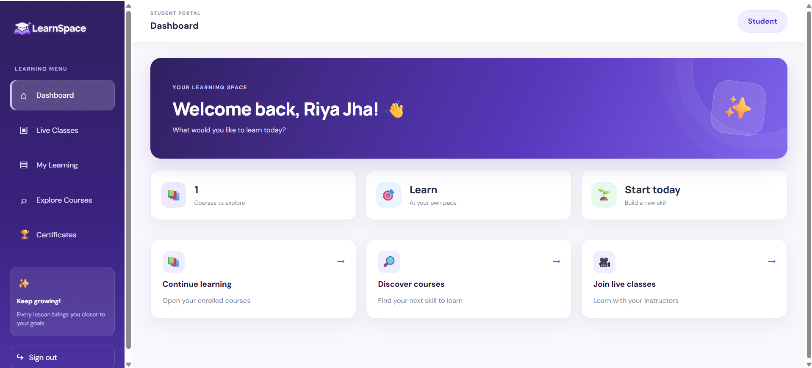
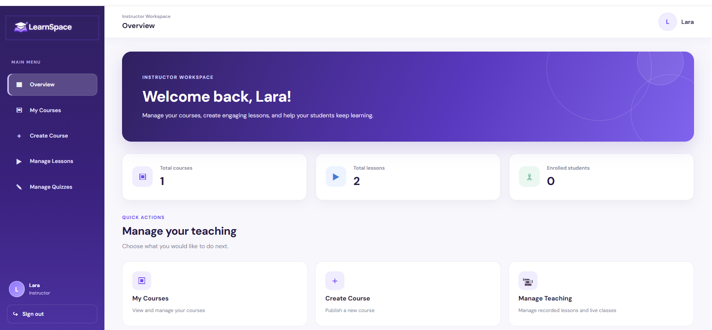
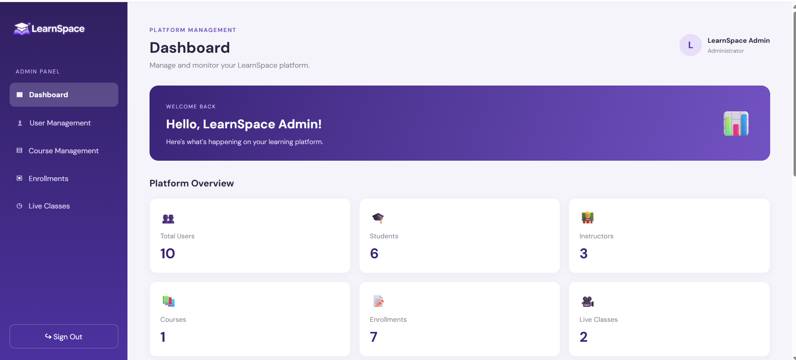

# LearnSpace LMS

**A Full-Stack Learning Management System**

LearnSpace is a web-based Learning Management System (LMS) designed to provide an interactive platform for students, instructors, and administrators. It helps manage courses, lessons, student enrollments, and live learning activities through role-based dashboards.

## Features

### Student
- Student registration and login
- Browse available courses
- Enroll in courses
- Access course lessons
- Track learning progress
- View live classes

## Project Screenshots

### Student Dashboard


### Instructor Dashboard


### Admin Dashboard


### Instructor
- Instructor dashboard
- Manage courses and lessons
- Add learning materials
- Manage live classes

### Admin
- Admin dashboard
- Manage users and instructors
- Manage courses and platform activities
- Monitor platform information

## Technologies Used

**Frontend**
- React.js
- HTML
- CSS
- JavaScript

**Backend**
- Node.js
- Express.js

**Database**
- MongoDB
- Mongoose

**Tools**
- Visual Studio Code
- Git and GitHub
- Postman

## Project Structure

```text
LearnSpace-LMS/
├── client/          # React frontend
├── server/          # Node.js backend
└── README.md
```

## Installation and Setup

### 1. Clone the repository

```bash
git clone https://github.com/mishrasakshi10/LearnSpace-LMS.git
cd LearnSpace-LMS
```

### 2. Install frontend dependencies

```bash
cd client
npm install
```

### 3. Install backend dependencies

Open another terminal:

```bash
cd server
npm install
```

### 4. Configure environment variables

Create a `.env` file in the server directory and add the environment variables required by the project.

Example:

```env
PORT=5000
MONGODB_URI=your_mongodb_connection_string
```

Use the exact variable names expected by your backend configuration.

### 5. Run the application

Start the backend and frontend in separate terminals using the scripts configured in their respective `package.json` files.

## Future Enhancements

- Online payment integration
- Advanced learning analytics
- Course ratings and reviews
- Improved live learning features

## Author

**Sakshi Mishra**

B.Sc. Information Technology Graduate

GitHub: [@mishrasakshi10](https://github.com/mishrasakshi10)

---

*LearnSpace LMS – Making online learning more accessible and organized.*